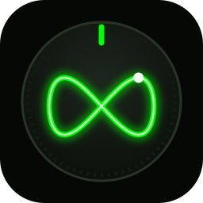

<p align="center">
  
</p>

<h1 align="center">infinity-knobs</h1>

<p align="center">Precise, endless MIDI knobs in the browser.</p>

<p align="center">
  <a href="https://www.npmjs.com/package/infinity-knobs"></a>
  <a href="https://github.com/LeonFedotov/infinity-knobs/actions/workflows/ci.yml"></a>
  <a href="https://leonfedotov.github.io/infinity-knobs/examples/"></a>
</p>

---

A MIDI knob sends a 7-bit value: 128 positions from end to end. That is too coarse to land on an exact value (spread over 20 Hz–20 kHz, the steps are almost a semitone apart), and the knob runs out at either end, even when the hardware itself turns forever.

infinity-knobs reads a knob's movement instead of its position. Turned slowly, each value is a tiny step; spun hard, a big one. And on controllers that accept values sent back to them, it keeps the knob away from its ends, so it never runs out.

It was written for [curve](https://curve.localheist.com) and tuned on an Akai MPD218, but it works with any controller that sends Control Change messages.

## Features

- **Acceleration.** Steps grow with the cube of the turning speed, from a fine step to a coarse one, in your own units (cents, degrees, decibels…). Every turn also reports its `speed` (0 to 1) and `rate` (values a second), for UIs that want to show them.
- **Endless knobs** without reprogramming the controller: a knob near either end is sent back to the middle, and carries on from there. Messages that were already on their way are read correctly, and controllers that ignore the reset keep working.
- **Relative encoders**: decoders for two's complement, binary offset and sign-magnitude, plus absolute knobs.
- **Value helpers**: exponential steps (cents, for frequencies), linear steps within a range, and wrapping (for angles and phase).
- **Web MIDI layer**: listens to every input, including devices plugged in later, keeps state per input, channel and CC, and finds the right output port for resets. `knob()` owns a value with a range and a scale and calls you back when it changes.
- TypeScript, ESM, no runtime dependencies. The core is pure functions with no DOM or Web MIDI, so it runs and tests in Node.

## Install

```sh
pnpm add infinity-knobs
# or: npm install infinity-knobs
```

## Quick start

```js
import { knob, requestMidiAccess } from 'infinity-knobs'

const access = await requestMidiAccess()

// The first knob of an MPD218 (CC 3) tunes an oscillator from 20 Hz to 20 kHz:
// a quarter of a cent per value when turned slowly, 50 cents per value when spun hard.
const frequency = knob(access, {
  cc: 3,
  value: 440,
  min: 20,
  max: 20000,
  scale: 'exponential', // steps are cents: 1200 doubles the value
  fine: 0.25,
  coarse: 50,
  onChange: (hz) => {
    oscillator.frequency.value = hz
  },
})

// Later:
frequency.dispose()
```

To handle every knob yourself, use `listen`:

```js
import { listen } from 'infinity-knobs'

const listener = listen(access, {
  fine: 0.1, // your units per value, slow…
  coarse: 5, // …and fast
  endless: true, // send knobs near their ends back to the middle
  onTurn: ({ cc, channel, step, speed }) => {
    // move whatever `cc` controls by `step`
  },
})
```

Without Web MIDI, the pure functions do the same with messages you get elsewhere:

```js
import { exponential, recentre, shouldRecentre, turnTo } from 'infinity-knobs'

let state // the knob's state, kept between messages
let hz = 440

function onControlChange(value, time) {
  const turn = turnTo(state, value, time, { fine: 0.25, coarse: 50 })
  hz = exponential(hz, turn.step, 20, 20000)
  state = turn.state
  if (shouldRecentre(state)) {
    sendToController(64) // the same CC and channel, back to the device
    state = recentre(state)
  }
}
```

## API

### Web MIDI

#### `knob(access, options): Knob`

A value between `min` and `max` that one knob turns.

```ts
function knob(access: MIDIAccess, options: KnobOptions): Knob

interface KnobOptions {
  cc: number                 // the knob's Control Change number
  value: number              // starting value
  min: number
  max: number
  fine: number               // step per value when turned slowly, in the scale's units
  coarse: number             // step per value when turned fast
  scale?: 'linear' | 'exponential' | 'wrap' | Scale  // default 'linear'
  endless?: boolean          // default true
  encoding?: Encoding        // default 'absolute'
  channel?: number           // 0–15; default every channel
  input?: (input: MIDIInput) => boolean  // default every input
  fastRate?: number          // default 400 values a second
  pauseMs?: number           // default 250
  centre?: number            // default 64
  margin?: number            // default 16
  onChange?: (value: number, turn: MidiTurn) => void
}

interface Knob {
  readonly value: number
  set(value: number): void   // kept within the range; does not call onChange
  dispose(): void
}
```

Scales: `'linear'` adds the step and stays within the range; `'exponential'` takes the step in cents (1200 doubles the value) and needs `min` above 0; `'wrap'` goes round from `max` to `min`, for angles and phase. A function `(value, step, min, max) => number` works too. `knob` throws a `RangeError` if `min` is not below `max`, or if an exponential knob's `min` is not above 0.

`endless` is on by default for `knob`, since you named the CC as a knob. On a controller that ignores the reset nothing changes (see [How endless works](#how-endless-works)).

#### `listen(access, options): Disposable`

Listens to every input of `access`, including ones plugged in later, and calls `onTurn` for each Control Change. State is kept per input, channel and CC.

```ts
function listen(access: MIDIAccess, options: ListenOptions): { dispose(): void }

interface ListenOptions {
  onTurn: (turn: MidiTurn) => void
  fine: number
  coarse: number
  encoding?: Encoding | ((cc: number, channel: number) => Encoding)  // default 'absolute'
  endless?: boolean | ((cc: number, channel: number) => boolean)     // default false
  cc?: number                // only this CC
  channel?: number           // only this channel, 0–15
  input?: (input: MIDIInput) => boolean
  fastRate?: number
  pauseMs?: number
  centre?: number
  margin?: number
}

interface MidiTurn {
  cc: number                 // 0–127
  channel: number            // 0–15
  value: number              // the value the knob sent, 0–127
  delta: number              // values moved since its last message (decoded, for relative knobs)
  step: number               // the accelerated step, in your units
  speed: number              // 0 at rest to 1 at fastRate and above
  rate: number               // values a second, smoothed
  time: number               // the message's timeStamp, in ms
  recentred: boolean         // whether a reset was sent after this message
  input: MIDIInput
}
```

`endless` is off by default for `listen`, because it sees every CC, including faders and buttons that should not be sent anything. Turn it on, or pass a function to choose the CCs.

`dispose()` removes only this listener's handlers. Other listeners, and any `onmidimessage` handler of your own, keep working. Ports are left open.

#### `requestMidiAccess(options?): Promise<MIDIAccess>`

Calls `navigator.requestMIDIAccess` (default `{ sysex: false }`), and rejects with a readable message if Web MIDI is not available or the page is not a secure context. The rest of the library never asks for access itself: pass it a `MIDIAccess` from anywhere.

#### `outputFor(access, input): MIDIOutput | undefined`

The output port of the device `input` belongs to: the output with the same name and manufacturer. Resets are sent there.

### Pure core

These have no DOM or Web MIDI dependency. Times are in milliseconds from any clock.

```ts
function turnTo(state: KnobState | undefined, value: number, time: number, acceleration: Acceleration): Turn
function turnBy(state: Motion | undefined, delta: number, time: number, acceleration: Acceleration): Turn<Motion>
function shouldRecentre(state: KnobState, options?: { margin?: number }): boolean
function recentre(state: KnobState, options?: { centre?: number }): KnobState

interface Acceleration { fine: number; coarse: number; fastRate?: number; pauseMs?: number }
interface Motion { time: number; rate: number }
interface KnobState extends Motion { value: number; recentredFrom?: number }
interface Turn<S = KnobState> { state: S; delta: number; step: number; speed: number; rate: number }
```

- `turnTo` is for absolute knobs (a position from 0 to 127). Pass `undefined` for a knob's first message: it only records where the knob is, so touching a knob never makes it jump. Keep `turn.state` for the next message.
- `turnBy` is for relative knobs: pass the decoded move. There is no position to anchor, so the first message moves too, at rest speed.
- `shouldRecentre` is true when the knob is within `margin` of 0 or 127 and no reset is on its way. When it is, send `centre` (64) to the controller on the same CC and channel, then keep `recentre(state)`.

```ts
function decodeRelative(value: number, encoding: 'twos-complement' | 'binary-offset' | 'sign-magnitude'): number

function exponential(value: number, step: number, min: number, max: number, perDoubling = 1200): number
function linear(value: number, step: number, min: number, max: number): number
function wrap(value: number, step: number, min: number, max: number): number

const defaults: { fastRate: 400, pauseMs: 250, centre: 64, margin: 16 }
const CENTRE: 64
```

## How acceleration works

For each message:

```
rate  = (previous rate + |delta| / elapsed) / 2       values a second
        or just |delta| / elapsed after a pause longer than pauseMs
speed = min(1, (rate / fastRate)³)
step  = delta × (fine + (coarse − fine) × speed)
```

- **The cube** keeps slow turns fine. With curve's steps (`fine` 0.25 cents, `coarse` 50 cents) and the default `fastRate` of 400 values a second, a careful turn at 60 values a second steps about 0.42 cents per value, 130 values a second about 2 cents, 200 about 6.5 cents, and 400 or more the full 50 cents. A hard spin at 500 values a second moves 25,000 cents a second, so 20 Hz to 20 kHz (about 10 octaves) takes half a second, while a careful turn still lands within a cent.
- **Averaging** with the previous rate absorbs USB bursts: two messages that arrive a millisecond apart would otherwise look like a spin of thousands of values a second.
- **The pause** of 250 ms resets the speed, so the first nudge after the knob stops is fine again.
- **The first message only anchors** an absolute knob. Its old position is unknown, so moving from it would make the value jump.

`fastRate` (400) is calibrated on the MPD218: well above a careful turn (about 60 values a second, peaking near 130), and below a hard spin (about 500). Set `fastRate` and `pauseMs` for controllers that send faster or slower.

## How endless works

Measured on an Akai MPD218:

- Its six knobs are endless encoders with no clicks. In CC mode they send absolute values from 0 to 127, at most one message every 10 ms or so. A careful turn runs at about 60 values a second (peaking near 130); a hard spin at about 500, skipping up to 7 values per message.
- At 0 or 127 the knob goes silent while you keep turning. It does not repeat 127.
- If the host sends the knob's CC back to the device (say CC 3 = 64 on the same channel), the knob carries on from that value: the next message is 65 going up, 63 going down.

That last point is the trick. When a knob comes within `margin` (16) of either end, infinity-knobs sends `centre` (64) back on the same CC and channel, to the output port with the same name and manufacturer as the input. The knob carries on from the middle, so it never reaches an end. A margin of 16 leaves room for at least one more message at the hardest spin measured (7 values) while the reset is on its way.

**Messages in flight.** The device may already have sent a message or two from the old position before the reset reaches it. A message nearer the old position than the centre is measured from the old position, and the knob keeps waiting for the reset. The first message nearer the centre means it has arrived. Only one reset is outstanding at a time, so the device is never flooded.

**Controllers that ignore it.** Messages keep coming from near the old position, so they keep being measured from there: the knob works as an ordinary absolute knob and stops at its end. No second reset is sent. One limitation: when such a knob is later turned back to the middle, the message that lands nearest 64 is misread as a move from the centre, so that one step goes astray.

Controllers without an output port, or whose port has gone, are never sent anything and work as ordinary knobs.

**Alternatives on the MPD218.** The MPD218 Editor can set a knob to other modes:

- *Inc/Dec 1* sends NRPN: CC 99 and 98 select the knob's parameter, then CC 96 increments or CC 97 decrements it.
- *Inc/Dec 2* sends relative values on the knob's own CC. Akai does not document the encoding.

Both need the controller reprogrammed, and Inc/Dec 2's encoding is unknown, so the absolute mode with feedback is the default here. The relative decoders below are for controllers that document theirs.

## Relative encoders

Some controllers send moves rather than positions. Set `encoding` to match the controller's documentation:

| `encoding` | +1 | +2 | −1 | −2 | |
| --- | --- | --- | --- | --- | --- |
| `'twos-complement'` | 1 | 2 | 127 | 126 | 1–63 up, 127 down to 65 down |
| `'binary-offset'` | 65 | 66 | 63 | 62 | 64 plus the move |
| `'sign-magnitude'` | 1 | 2 | 65 | 66 | bit 6 is the sign, the low 6 bits the size |

Relative knobs are never sent resets; they have no ends. For an encoding not listed here, decode the value yourself and call `turnBy`.

## Browser support

Web MIDI works in Chrome (desktop and Android), Edge and Opera, and in Firefox 108 and later after a site permission prompt. Safari does not support it. Browsers may ask the user for permission to use MIDI devices.

Web MIDI needs a secure context: serve the page over https, or from `localhost` during development.

## Example

[`examples/index.html`](examples/index.html) shows a knob's value, speed, rate and resets. Try it live at [leonfedotov.github.io/infinity-knobs/examples](https://leonfedotov.github.io/infinity-knobs/examples/) with a MIDI controller plugged in; the Pages workflow publishes it on every push to `main`. To run it locally, build, then serve the repository root over localhost:

```sh
pnpm install
pnpm build
python3 -m http.server   # then open http://localhost:8000/examples/
```

## Development

```sh
pnpm install
pnpm typecheck   # tsc over src and test
pnpm test        # Node's built-in test runner, running the TypeScript directly
pnpm build       # compiles src to dist (JS and .d.ts)
```

The tests need Node 22.18 or later, for type stripping. The Web MIDI layer is tested against fake ports that behave like an MPD218: they clamp to 0–127, go silent at the ends, and take feedback one message late. There is no linter; the code uses single quotes, no semicolons and two-space indentation.

## Releasing

Publishing to npm is automatic: bump the version and push the tag.

```sh
npm version patch   # or minor or major: updates package.json, commits and tags vX.Y.Z
git push --follow-tags
```

The Publish workflow checks that the tag matches `package.json`, then runs the typecheck, tests and build and publishes. It uses npm [trusted publishing](https://docs.npmjs.com/trusted-publishers): npm accepts releases only from this repository's `publish.yml`, so no npm token is stored anywhere, and each release gets a provenance statement. A tag for a version that is already on npm is skipped.

## Made for curve

infinity-knobs was extracted from [curve](https://curve.localheist.com) ([source](https://github.com/LeonFedotov/curve)), an oscilloscope-style tool for exploring Lissajous figures, where it lets an MPD218 tune oscillators to within a fraction of a cent.

## License

[MIT](LICENSE) © 2026 Leon Fedotov
